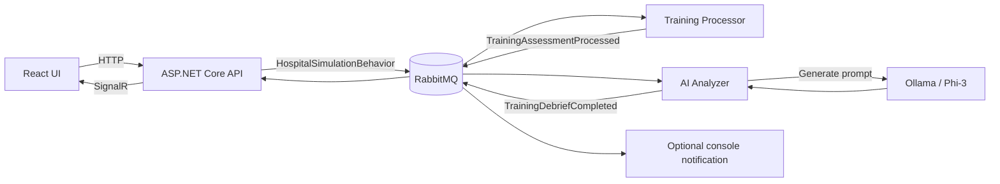

# CareSim — Hospital Simulation Training

> Phase 1 proof of concept for generating educator-reviewable learning prompts from simulated hospital staff behaviors.

[](https://dotnet.microsoft.com/)
[](https://react.dev/)
[](https://www.rabbitmq.com/)
[](https://ollama.com/)

## Overview

CareSim is an event-driven training simulation proof of concept. A learner selects a sample hospital scenario and an observed staff behavior in the React interface. The backend evaluates that behavior against an explicit scenario rubric, then uses a locally hosted Phi-3 model to generate a reflection question.

Phase 1 focuses on the domain and end-to-end workflow: React, ASP.NET Core, RabbitMQ, MassTransit, Ollama, and Phi-3. It does **not** use SQL or another application data store.

## What happens in a simulation

1. The React app loads the sample scenarios from the API.
2. The API validates the selected scenario and behavior, then publishes a `HospitalSimulationBehavior` message to RabbitMQ.
3. The processor maps the scenario's rubric result to a deterministic `TrainingOutcome`.
4. The AI analyzer asks local Ollama/Phi-3 for one draft reflection question.
5. The completed result is published to RabbitMQ. The API forwards it to the active browser over SignalR; the optional notification service also displays it in the console.

The browser never connects directly to RabbitMQ. A shared in-memory scenario catalog keeps the API and optional console simulator aligned.



## Architecture direction

The six layers are the longer-term architecture; Phase 1 implements only the initial vertical slice.

| Layer | Responsibility | Phase 1 |
|---|---|---|
| **01 — Presentation** | Dashboards, scenario management, and reporting | React scenario selection and feedback screen |
| **02 — API** | REST endpoints, validation, and API versioning | ASP.NET Core Minimal APIs, validation, OpenAPI, and SignalR |
| **03 — Business** | Scenarios, observed behaviors, assessment, and improvement workflows | Sample scenarios and deterministic rubric outcome |
| **04 — Integration** | Messaging, external APIs, and background workers | RabbitMQ and MassTransit |
| **05 — Data** | SQL, document storage, and caching | Out of scope; no application data store |
| **06 — AI** | LLM analysis, recommendations, and guardrails | One draft reflection question from local Ollama/Phi-3; the rubric remains deterministic |

## Technology

- .NET 10 and ASP.NET Core Minimal APIs
- React and TypeScript
- RabbitMQ and MassTransit
- Ollama with the Phi-3 (`phi3`) model
- SignalR for real-time results
- xUnit and GitHub Actions

## Run locally

### Prerequisites

- .NET 10 SDK
- Node.js 22.12+ and npm
- RabbitMQ listening at `localhost:5672`
- Ollama listening at `localhost:11434`

Pull the model once:

```bash
ollama pull phi3
```

If RabbitMQ is not already running, start a local instance:

```bash
docker run -d --name hospital-simulation-rabbitmq -p 5672:5672 -p 15672:15672 rabbitmq:3-management
```

### Start the backend

Run each required service in its own terminal from the repository root.

**Terminal 1 — training processor**

```bash
dotnet run --project AIHealthcareSimulation.Processor/AIHealthcareSimulation.Consumer.csproj
```

**Terminal 2 — AI analyzer**

```bash
dotnet run --project AIHealthcareSimulation.AIAnalyzer/AIHealthcareSimulation.AIAnalyzer.csproj
```

**Terminal 3 — API**

```bash
dotnet run --project AIHealthcareSimulation.Api/AIHealthcareSimulation.Api.csproj
```

The notification consumer is optional; it prints completed feedback in the console:

```bash
dotnet run --project AIHealthcareSimulation.Notification/AIHealthcareSimulation.Notification.csproj
```

### Start the frontend

From the repository root:

```bash
npm ci --prefix frontend
npm run dev --prefix frontend
```

Open `http://localhost:5173`. The API listens at `http://localhost:5277`; its OpenAPI document is available at `http://localhost:5277/openapi/v1.json` in Development.

The console simulator can be used instead of the browser to publish a sample behavior:

```bash
dotnet run --project AIHealthcareSimulation.Simulator/AIHealthcareSimulation.Simulator.csproj
```

### Verify changes

```bash
dotnet build AIHealthcareSimulation.PoC.slnx
dotnet test AIHealthcareSimulation.PoC.slnx
npm run build --prefix frontend
npm run lint --prefix frontend
```

## Safety and Phase 1 limitations

- Scenarios and behaviors are illustrative examples, not clinically validated training material.
- This is a training-only prototype, not clinical decision support. Do not enter real patient information.
- Rubric outcomes are deterministic. AI-generated reflection questions are drafts and should be reviewed by an educator.
- There is no authentication or application data store. Results are delivered to the active browser connection and are not available for later retrieval.

## Project structure

```text
AIHealthcareSimulation
├── AIHealthcareSimulation.Api             # REST API and SignalR result delivery
├── AIHealthcareSimulation.Simulator       # Optional console publisher
├── AIHealthcareSimulation.Processor       # Deterministic rubric outcome
├── AIHealthcareSimulation.AIAnalyzer      # Ollama/Phi-3 reflection question
├── AIHealthcareSimulation.Notification    # Optional console feedback consumer
├── AIHealthcareSimulation.Contracts       # Shared events and scenario catalog
├── AIHealthcareSimulation.Processor.Tests # Processor and catalog unit tests
└── frontend                                # React and TypeScript interface
```

## Author

**Rameshkumar Gudala**

Engineering Manager | Cloud Architecture | AI | Azure & AWS | .NET
